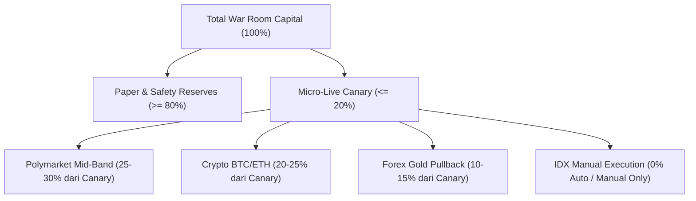
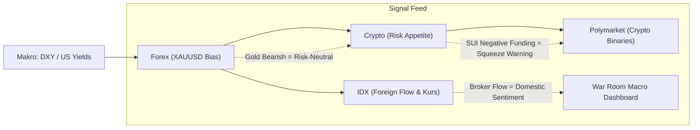

# Rekomendasi Strategis Konsensus Terpadu War Room
## Sintesis Audit Multipolar & Pedoman Kebijakan Lintas Pasar (Forex · Crypto · Polymarket · IDX)

**Tanggal Konsensus:** 23 Oktober 2026  
**Otoritas:** War Room Chief Orchestrator & Strategic Macro Council  
**Klasifikasi:** Internal Operasional — Terbatas (War Room Platform)  
**Status Keputusan Live:** 🛑 **NO-GO LIVE PENUH** (Kondisional: Hardening Teknis, Paper/Demo Mirror, dan Micro-Live Canary Bertahap)

---

## 1. Executive Summary & Ringkasan Konsensus

Berdasarkan audit teknis, kuantitatif, dan arsitektural menyeluruh yang dilakukan oleh masing-masing spesialis pasar di direktori `/home/admin/warroom-agents/` (Forex, Crypto, Polymarket, IDX), Chief Orchestrator bersama Strategic Macro Council menetapkan **Konsensus Terpadu**:

1. **Integritas Platform & Keamanan Fail-Closed Terverifikasi:**
   - Modul eksekusi live (`execution/live_venue.py` di Crypto dan `/etc/poly-pilot/activation-approved` di Polymarket) terbukti aman dan terkunci sempurna (**Fail-Closed**).
   - Tidak ada kebocoran kredensial, tidak ada pembuatan angka fiktif, dan batasan direktori baca-saja (`/opt/polymarket`, node Tencent) dipatuhi 100% sesuai [`AGENTS.md`](file:///home/admin/warroom-agents/orchestrator/AGENTS.md).
2. **Paradoks Edge Statistik vs Friksi Eksekusi Nyata:**
   - **Polymarket:** Ditemukan *statistical edge* empiris pada dataset historis QA ($n=4133$, WR 78.25%, EV +2.07%, $d_{\text{eff}}=1.342$), namun **paper mirror Arm B merugi (-6.40%)** pada ask band tinggi ($0.70\text{--}0.95$) akibat asimetri payoff ($+0.22\times$ vs $-1.0\times$) dan beban biaya *taker receipt* ($26.86 USD).
   - **Forex (XAUUSD):** Tren H1 bearish kuat terdeteksi presisi oleh scanner TradingView, namun buffer Breakeven saat ini ($0.30 / 30 pts) pada `LayaGoldEA.mq5` rentan terhadap pelebaran spread Exness (40–80 pts) pada sesi rollover atau berita berdampak tinggi.
3. **Kesiapan Eksekusi Bertingkat:**
   - Tidak ada satu pun pasar yang diizinkan untuk *full unhedged live deployment* hari ini.
   - Kebijakan yang disepakati adalah **Hardening Paralel**, diikuti oleh **Paper Mirroring Terisolasi**, dan diakhiri dengan **Micro-Live Canary** bertahap dengan rasio modal paper-to-live minimal $3:1$.

---

## 2. Matriks Komparatif Audit Spesialis Pasar

| Dimensi / Pasar | Forex & Gold (`forex`) | Crypto & Altcoins (`crypto`) | Polymarket Binary (`polymarket`) | IDX Equities (`idx`) |
|---|---|---|---|---|
| **Kondisi Pasar Terkini** | Bearish H1 Kuat (Close $4004.39 < EMA20 $4039.93), Rentang $45.87 | Likuidasi stabil; BTC $81.6k, ETH $2.39k. SUI short-crowded (-0.0025% funding). | Jendela 5m BTC/ETH likuid; ask rata-rata $0.7666. | IHSG defensif; akumulasi broker terdeteksi pada saham terpilih. |
| **Status Engine / Codebase** | `forex.py` & WebSocket 100% hijau; scanner sweep filter aktif ($10–$35). | Snapshot Binance/OKX presisi; DEXScreen token boost aktif. | Radar lokal Webdock stabil (Azure dipensiunkan); dompet virtual terintegrasi. | Pipeline Arjum API stabil; 39 unit test passed; kuota guard anti-freeze teruji. |
| **Vektor Risiko Kritis** | Buffer BE $0.30 tergerus spread rollover Exness (40–80 pts). | Turnover BNB rendah (0.58x); polusi token scam pump.fun di DEXScreen. | Asimetri R:R di band ask $0.70–$0.95 + fee taker CLOB memakan saldo. | Blind spot data Level II (High Bid/Offer & High Non-Regular). |
| **Status Live Venue** | Conditional (Butuh forward demo MT5 14 hari). | Terkunci total (tri-lock: `izin=False`, `kunci=False`, `siap=False`). | Terkunci total (gate `/etc/poly-pilot/activation-approved` perawan). | Cap Fase 2 dipertahankan (sinyal mirror, eksekusi manual di broker). |
| **Tingkat Kesiapan Live** | 🟡 **KONDISIONAL (75%)** | 🟡 **KONDISIONAL (80%)** | 🟡 **KONDISIONAL (75%)** | 🟢 **SIAP FASE 2 (MANUAL)** |

---

## 3. Alokasi Prioritas & Pengelolaan Modal Portofolio

### 3.1 Prinsip Pengelolaan Modal War Room
1. **Edge-First, Bukti Terverifikasi:** Alokasi modal mengikuti validasi statistik empiris dengan $N_{\text{eff}}$ yang memadai, bukan mengejar volatilitas spekulatif.
2. **Zero-Capital Live pada Komponen Berstatus Block:** Setiap modul yang belum memiliki spread guard dinamis atau kalkulasi Net EV positif pasca-fee dilarang menyentuh saldo riil.
3. **Pemisahan Tegas Paper vs Live:** Kerugian eksperimental pada paper mirror (seperti Arm B/Arm D) tidak boleh memengaruhi integritas sistem live.

### 3.2 Matriks Alokasi Modal Strategis



- **Fase Awal (Hardening & Paper):**
  - **100% Modal** berada pada lingkungan simulasi paper/demo.
  - Alokasi Dompet Virtual: Polymarket Rp 10.000.000 (proporsional Arm B), Forex Akun Demo Exness $1.000, Crypto Paper Sandbox $1.000.
- **Fase Transisi (Micro-Live Canary — Maksimal 20% Total Kapasitas):**
  - **Polymarket (30% dari porsi Canary):** Khusus kontrak biner mid-band ($0.55\text{--}0.72$) dengan estimasi $\text{Net EV} \ge +2.5\%$.
  - **Crypto (25% dari porsi Canary):** Pasangan likuiditas tinggi (BTCUSDT, ETHUSDT) dengan leverage konservatif ($\le 2\times$), mengesampingkan koin berisiko likuiditas rendah seperti BNB.
  - **Forex (15% dari porsi Canary):** Lot mikro ($0.01\text{--}0.02$) pada XAUUSD hanya saat sesi likuid London/New York, dengan spread guard aktif.
  - **IDX (0% Auto-Order):** Dipertahankan pada **Cap Fase 2** (hanya rekomendasi analitik bandarmologi terkurasi untuk dieksekusi manual oleh trader di broker lokal).

---

## 4. Sinergi Makro Lintas Aset (Cross-Asset Intelligence)

Untuk menciptakan keunggulan kompetitif sistemik, War Room mengintegrasikan arus intelijen lintas pasar:



1. **Transmisi Emas (XAUUSD) ke Crypto:**
   - Pelemahan emas intraday ($4004.39, tren bearish H1) merefleksikan penguatan real yield / DXY. Kondisi ini menjadi sinyal rem (*caution*) bagi leverage posisi long di Crypto, mencegah eksposur berlebihan saat likuiditas makro mengetat.
2. **Derivatif Crypto ke Pasar Biner Polymarket:**
   - Anomali funding rate negatif SUI (-0.0025%) dengan volume tinggi menandakan kondisi *short crowded*. Intelijen ini dialirkan ke bot Polymarket untuk mendeteksi mispricing pada kontrak biner berbasis event harga crypto (mencegah pembelian share DOWN saat potensi squeeze membayangi).
3. **Korelasi Kurs USD/IDR dan Valuasi Portofolio:**
   - Pelindung kurs offline pada `dompet.py` diperluas: jika deviasi kurs USD/IDR harian melonjak $>2.0\%$, sistem secara otomatis membekukan rebalancing nilai dompet virtual guna mencegah distorsi PnL akibat volatilitas valas.
4. **Foreign Flow IDX sebagai Indikator Sentimen Regional:**
   - Data foreign net buy dari broker summary Arjum memberikan konfirmasi apakah arus modal institusi global sedang masuk (*inflow*) atau keluar (*outflow*) dari pasar berkembang (*emerging markets*).

---

## 5. Protokol Mitigasi Risiko & Arsitektur Fail-Closed

Mengadopsi pola pertahanan berlapis dari modul Crypto, seluruh sistem War Room diwajibkan menerapkan standar **Quad-Lock Gate**:

```
[Level 1: Izin Eksplisit Owner]  --->  /etc/poly-pilot/activation-approved atau /etc/warroom/*-approved
             |
[Level 2: Kunci & Kredensial]   --->  API Keys valid di /etc/warroom/*.env (Mode 600)
             |
[Level 3: Filter Kesiapan Data] --->  Data feed fresh, Quota aman, Bias H1 sinkron
             |
[Level 4: Dynamic Friction Guard] ->  Forex: Spread <= 30 pts | Polymarket: Net EV >= +2.5% | Crypto: Liq >= $50k
             |
       [EKSEKUSI ORDER]
```

### 5.1 Rencana Aksi Remediasi Teknis Pra-Live

#### A. Forex & Gold (XAUUSD)
- **Implementasi Spread Guard:** Tambahkan variabel `InpMaxBESpreadPoints = 30` pada `LayaGoldEA.mq5`. Jika spread pasar saat pergeseran $> 30$ points, tahan pergeseran SL hingga spread kembali normal.
- **Peningkatan Buffer Breakeven:** Naikkan buffer standar dari `$0.30` menjadi **`$0.40 - $0.50`** untuk mengompensasi slippage terminal dan biaya swap/rollover broker.
- **Sinkronisasi Bias Otomatis:** Sambungkan endpoint `laya_service.py` (`/bias`) langsung ke komputasi EMA20/50 dari `collectors/forex.py` guna mencegah EA mengambil posisi kontra-tren H1.

#### B. Crypto & Derivatif
- **Delta Open Interest Real-Time:** Perbarui `collectors/crypto.py` agar mencatat riwayat ringkas delta OI ($\Delta\text{OI}_{1\text{h}}$ dan $\Delta\text{OI}_{4\text{h}}$) untuk mendeteksi awal mula likuidasi kaskade.
- **Filter Kebisingan DEX:** Terapkan filter likuiditas minimum $\ge \$50,000$ USD dan umur pool $\ge 2$ jam pada parser `collectors/dexscreen.py` untuk mengeliminasi token spekulatif *pump.fun*.
- **Adaptive Taker Ratio:** Gantikan ambang statis ($1.2 / 0.8$) dengan rolling z-score untuk menangkap anomali agresi beli/jual secara lebih sensitif.

#### C. Polymarket
- **Migrasi ke Mid-Band Odds ($0.55\text{--}0.72$):** Hentikan eksekusi pada rentang ask mahal ($0.70\text{--}0.95$) yang memiliki payout tipis ($+0.11\times$ s/d $+0.33\times$). Fokuskan model pada rentang harga menengah dengan rasio payout seimbang ($+0.39\times$ s/d $+0.81\times$).
- **Evaluasi Net EV Real-Time Pasca-Fee:** Wajibkan kalkulasi margin bersih sebelum entry:
  $$\text{Net EV} = p_{\text{model}} \cdot (1 - \text{ask} - \text{fee}) - (1 - p_{\text{model}}) \cdot (\text{ask} + \text{fee}) \ge +0.025 \ (+2.5\%)$$
- **Pertahankan Target Sampel $N_{\text{needed}} = 7,392$:** Lanjutkan pencatatan paper shadow hingga sampel efektif terpenuhi sebelum mengajukan permohonan live gate ke pemilik.

#### D. IDX Equities
- **Disiplin Cap Fase 2:** Pertahankan batas arsitektur di mana pod IDX hanya menerbitkan sinyal mirror dan perhitungan konsentrasi risiko, sedangkan eksekusi order tetap berada di tangan manusia melalui aplikasi sekuritas resmi.
- **Penjagaan Kuota Arjum:** Pertahankan limit `maks_ticker=8` pada skrining harian dan pantau rotasi log harian `arjum_audit_*.jsonl` agar tidak terjadi penumpukan kapasitas penyimpanan lokal.

---

## 6. Roadmap Implementasi Bertahap

| Tahapan | Durasi / Target | Syarat Kelulusan (*Exit Criteria*) | Status |
|---|---|---|---|
| **Fase 1: Hardening & Remediasi Kode** | 1–2 Minggu | 1. Spread guard & buffer $0.40 terpasang di EA Forex.<br>2. Filter likuiditas DEX & delta OI terintegrasi di Crypto.<br>3. Kalkulator Net EV pasca-fee aktif di Polymarket.<br>4. Seluruh test suite (Python pytest & Vitest) lulus 100%. | 🔄 **SEDANG BERJALAN** |
| **Fase 2: Paper & Forward Demo Mirror** | 14 Hari Kalender | 1. Forward-test EA Forex di Exness MT5 Demo minimal 14 hari tanpa kegagalan slippage BE.<br>2. Polymarket Arm B v2 (mid-band) membukukan PnL net positif.<br>3. Nol insiden fail-closed bypass pada seluruh kolektor. | ⏳ **MENUNGGU FASE 1** |
| **Fase 3: Canary Micro-Live** | 2–4 Minggu | 1. Izin tertulis owner via gate `/etc/warroom/*-approved`.<br>2. Eksekusi mikro ($\le \$2$ per order crypto/polymarket, $0.01$ lot forex).<br>3. Rasio modal paper:live dipertahankan $\ge 3:1$. | ⏳ **TERKUNCI** |
| **Fase 4: Full Orchestration** | Milestone Evaluasi | Portofolio live terbukti menghasilkan return stabil dengan drawdown terkontrol di bawah batas toleransi owner. | 🔒 **TERKUNCI** |

---

## 7. Rekomendasi Resolusi untuk Dewan War Room

Chief Orchestrator merekomendasikan kepada Pemilik Platform (*Owner*) untuk mengesahkan 5 ketetapan operasional berikut:

1. **Mengesahkan Status NO-GO Live Penuh** untuk seluruh instrumen hingga kriteria penyelesaian Fase 1 dan 2 terpenuhi secara faktual.
2. **Menyetujui Perubahan Parameter EA LayaGold:** Mengizinkan pembaruan kode pada `LayaGoldEA.mq5` untuk menyertakan `InpMaxBESpreadPoints = 30` dan menaikkan buffer BE menjadi `$0.40`.
3. **Mengesahkan Migrasi Strategi Polymarket:** Mengalihkan fokus pencarian mispricing dari high-odds favorit ($>0.75$) ke mid-band ($0.55\text{--}0.72$) dengan *fee-adjusted hurdle rate* sebesar $+2.5\%$.
4. **Menetapkan Standar Keamanan Quad-Lock** sebagai prasyarat wajib pada seluruh repositori spesialis pasar sebelum modul live dihubungkan ke jaringan produksi.
5. **Mempertahankan Cap Fase 2 pada Pasar IDX** demi menjaga keselamatan modal dari keterbatasan data level II dan ketiadaan jalur direct market access (DMA) otomatis.

---
*Dokumen konsensus ini disusun secara independen, objektif, dan berbasis data telemetri aktual oleh Chief Orchestrator bersama seluruh entitas spesialis pasar War Room.*
