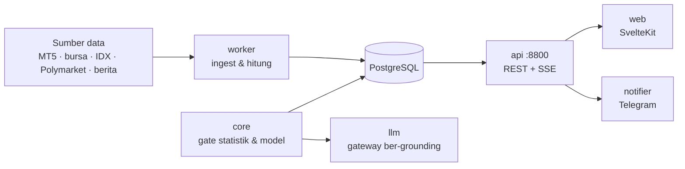

# War Room

  
  
  
  
  

**Satu layar untuk melihat dan mengoperasikan seluruh sistem trading**: crypto, IDX, forex,
Polymarket, meme coin, dan Sistem & AI. Tujuannya sederhana — saat kamu membuka Home, kamu
tahu dalam beberapa detik pasar mana yang punya sinyal, seberapa layak, dan apa risikonya,
tanpa berpindah alat.

Pembeda yang dipegang sistem ini:

- **Satu kartu sinyal terbaik per pasar di Home.** Bukan dinding widget, bukan grid grafik.
- **Kejujuran angka.** Sistem menandai mana angka **terukur** dan mana yang **belum
  terverifikasi**, dan tidak menampilkan `0` ketika artinya "tidak ada data" (kosong = `—`).

Detail produk: [`PRODUCT.md`](PRODUCT.md) · Diagram sistem: [`docs/arsitektur.md`](docs/arsitektur.md)

---

## Cara buka demo

**https://0xgunsl1ng3r.xyz** — buka di peramban, lalu masuk di `/masuk`.

Halaman utama bisa dilihat sebagian tanpa login; area yang butuh data (dan semua `/api/*`)
memerlukan sesi. Kredensial **tidak pernah** dibagikan di repo ini.

## Pakai dalam 4 langkah

1. **Buka** https://0xgunsl1ng3r.xyz dan **masuk** di `/masuk`.
2. **Mulai dari Home** — lihat mana pasar yang punya sinyal paling layak saat ini.
3. **Telusuri satu pasar** (crypto / IDX / forex / Polymarket / GMGN / Sistem) untuk melihat
   **kenapa**: angka, status kesegaran data, dan `catatan_kejujuran` di tiap angka.
4. **Tindak lanjuti** ke paper trade untuk menyiapkan keputusan sebelum uang nyata; live hanya
   dengan izin eksplisit owner.

> Angka di layar datang dari snapshot yang dihitung worker; halaman **menampilkan** kebenaran
> yang sudah dihitung, bukan menghitung sendiri di UI.

## Perintah harian (paket utama)

| Tujuan | Perintah |
|---|---|
| Dev: API + worker + web sekaligus | `scripts/dev.sh` |
| Dev tanpa memasang apa pun (butuh Docker) | `docker compose -f docker-compose.dev.yml up` |
| Sinkronisasi environment | `uv sync --frozen` |
| Lint Python | `uv run ruff check .` |
| Tes platform (butuh Postgres) | `uv run pytest -q` |
| Tes live-trading | `uv run pytest packages/live-trading -q` |
| Cek skema DB di head alembic | `uv run python ops/check-db-head.py --upgrade` |
| Jalankan API (dev) | `uv run uvicorn warroom_api.app:app --port 8800` |
| Jalankan web (dev) | `cd apps/web && npm run dev` |
| Web: check + test + build | `cd apps/web && npm run check && npm run test && npm run build` |
| Web: deteksi kode mati | `cd apps/web && npm run knip` |
| Python: deteksi kode mati | `uvx vulture packages/core/src packages/live-trading/src services tools ops/vulture-whitelist.py --min-confidence 90` |
| Cek rahasia bocor (history) | gitleaks — otomatis di CI |

## Cara kerja (ringkas)

Alur lengkap, strategi plug-and-play (PnP), dan gerbang keselamatan live:
**[`docs/arsitektur.md`](docs/arsitektur.md)**.

## Struktur repo

| Lokasi | Isi |
|---|---|
| `packages/core/` | Model DB, evaluasi gate statistik, data splits, retensi |
| `packages/live-trading/` | Mesin analisis multi-pasar, CLI `lt`, kalkulator risiko & dompet |
| `services/api/` | FastAPI :8800 — REST & stream SSE, auth cookie & RBAC |
| `services/worker/` | Job runner latar belakang & penerbit fakta |
| `services/notifier/` | Notifikasi Telegram Hermes & webhook retry |
| `services/llm/` | Gateway LLM ber-grounding fakta dengan circuit breaker |
| `apps/web/` | Antarmuka SvelteKit 2, desain Serene Capital |
| `docs/` | Dokumentasi teknis, arsitektur, dan laporan audit/QA (`docs/laporan/`) |
| `ops/` | Skrip operasional (cek head DB, kontrak OpenAPI, anggaran baris, whitelist vulture) |
| `scripts/` | Skrip backtest & analisis |
| `.github/workflows/` | CI: platform, domain, secrets, web, hygiene |

## Gerbang mutu (CI)

Semua PR wajib lulus 4 check di [`ci.yml`](.github/workflows/ci.yml); `main` terkunci
branch protection (`strict`, tanpa force-push/delete, riwayat linear):

| Check | Isi |
|---|---|
| `platform (warroom) — sync + ruff + import domain` | uv sync, ruff, impor domain, kontrak OpenAPI, anggaran baris, head alembic, pytest penuh |
| `domain (packages/live-trading) — ruff + pytest` | Lint & tes paket live-trading |
| `secrets — gitleaks` | Scan kredensial di seluruh git history |
| `web — npm ci + build` | Lint token, svelte-check, tes, **knip** (kode mati), build |
| `hygiene — vulture` | Deteksi kode mati Python (confidence ≥ 90, whitelist di `ops/`) |

## Aturan yang tidak boleh dilanggar

Lihat [`AGENTS.md`](AGENTS.md). Ringkasnya: `/opt/polymarket` baca-saja, Tencent baca-saja
(Azure sudah dilepas 6 Okt — radar rantai kini lokal di host ini),
gate live tidak pernah disentuh, kredensial tidak pernah masuk repo/log/percakapan,
angka tidak boleh dikarang, dan ambang gate & rumus BE hanya boleh diubah manusia (owner).

## Keamanan & privasi

- Kredensial hanya lewat `.env` (tidak pernah di-commit — dijaga gitleaks di CI).
- Semua `/api/*` butuh sesi; aksi sensitif lewat RBAC.
- Strategi eksternal (PnP) dimuat **fail-closed**: error saat muat = gagal start, tanpa
  registrasi parsial. Detail: [`docs/arsitektur.md`](docs/arsitektur.md).

## Untuk pengembang

Panduan teknis (stack, struktur folder, perintah harian, environment, deploy nginx/systemd)
ada di **[`docs/pengembangan.md`](docs/pengembangan.md)**. Operasional harian (restart layanan,
log, gate blocking, backup/restore Postgres) ada di **[`docs/runbook.md`](docs/runbook.md)**.
Diagram sistem di [`docs/arsitektur.md`](docs/arsitektur.md). Aturan kerja & keselamatan ada di
[`AGENTS.md`](AGENTS.md). Dilarang push langsung ke `main` — semua perubahan lewat branch → PR
(lihat `.github/pull_request_template.md`). Setup & inventaris akun MT5 (Wine) ada di
**[`docs/mt5-wine-akun.md`](docs/mt5-wine-akun.md)**.

### Dokumentasi Paket & Layanan

- [`packages/core`](packages/core/README.md) — Model DB, evaluasi gate statistik, data splits, retensi
- [`packages/live-trading`](packages/live-trading/README.md) — Mesin analisis multi-pasar, CLI `lt`, kalkulator risiko & dompet
- [`services/api`](services/api/README.md) — FastAPI :8800 REST & stream SSE, auth cookie & RBAC
- [`services/worker`](services/worker/README.md) — Job runner latar belakang & penerbit fakta
- [`services/notifier`](services/notifier/README.md) — Notifikasi Telegram Hermes & webhook retry
- [`services/llm`](services/llm/README.md) — Gateway LLM ber-grounding fakta dengan circuit breaker
- [`apps/web`](apps/web/README.md) — Antarmuka SvelteKit 2, desain Serene Capital

## Kontribusi

1. Buat branch dari `main` (format: `p<N>-<slug>` atau `<topik>/<slug>`).
2. Commit mengikuti **Conventional Commits** (`feat:`, `fix:`, `docs:`, `chore:`, …).
3. Pastikan lokal hijau: `uv run ruff check .`, `uv run pytest -q`,
   `cd apps/web && npm run check && npm run knip`.
4. Buka PR dengan template `.github/pull_request_template.md`; tunggu 4 required check hijau
   sebelum merge (squash).

Catatan perubahan seluruh sektor terdokumentasi di [**`CHANGELOG.md`**](CHANGELOG.md).
