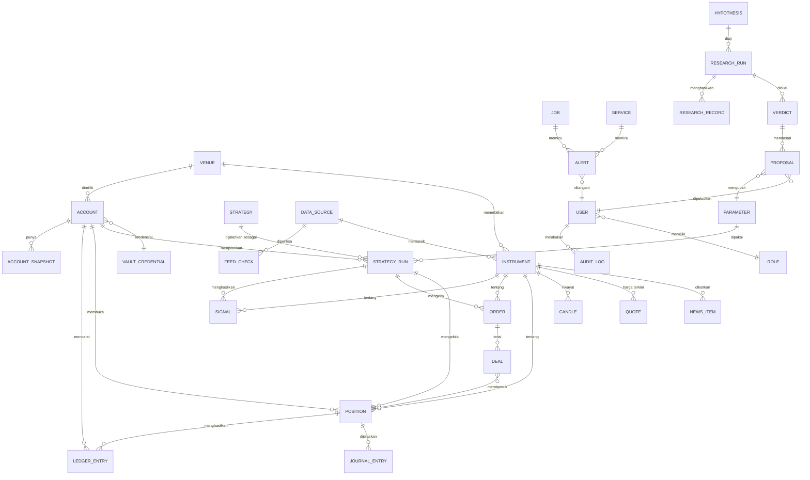

# ERD — War Room Overhaul (v2026.11)

Pendamping `prd-warroom-202611.md`. Semua nama tabel `snake_case`, singular.

---

## 1. Prinsip model

1. **Ternormalisasi untuk hal yang uang; longgar untuk hal yang eksperimen.**
   `position`, `ledger_entry`, `account_snapshot` rapi dan ketat. Riset boleh `jsonb`.
2. **`facts` bukan model, tapi staging.** Sekarang 371 MB / 155k baris dan jadi tempat
   semua hal. Setelah overhaul: `facts` hanya titik masuk mentah + TTL 30 hari; angka
   yang dipakai UI hidup di tabel bertipe.
3. **Satu market = satu `market` enum di `instrument`.** Tidak ada tabel per market.
4. **Akun live & demo & paper sama-sama `account` dengan `mode`.**
5. **Kredensial tidak pernah di tabel domain.** `account.vault_credential_id` menunjuk ke
   `vault_credential` (ciphertext), tidak ada kolom password di `account`.
6. **Setiap aksi tulis → `audit_log`.** Bukan opsional, bukan "nanti".

---

## 2. Diagram (Mermaid)

---

## 3. Entitas & kolom kunci

### 3.1 Referensi

**`venue`** — broker/exchange/prediction/chain
`id, code (unique: 'exness','okx','polymarket','idx','gmgn'), kind, name, timezone, active`

**`account`**
`id, venue_id→venue, label, login_ext, currency, leverage, mode (live|demo|paper),
status (ok|expired|error), vault_credential_id→vault_credential, margin_mode,
created_at, updated_at`
Unique: `(venue_id, login_ext, mode)`.

**`instrument`**
`id, venue_id→venue, market (forex|crypto|prediction|equity|onchain), symbol,
kind (spot|perp|future|stock|binary|token), quote_currency, tick_size, contract_size,
digits, active`
Unique: `(venue_id, symbol, kind)`.

**`strategy`**
`id, code (unique), name, market, version, repo_ref, status (draft|paper|live|retired),
description`

**`strategy_run`** — satu instance EA/engine yang benar-benar jalan
`id, strategy_id→strategy, account_id→account, instrument_id→instrument, magic,
params_json, preset_name, host, unit, started_at, stopped_at, status, last_heartbeat_at`
Unique parsial: satu `(account_id, magic)` aktif.

### 3.2 Trading

**`signal`** — keputusan engine, termasuk yang **ditolak** (ini yang menjawab "kenapa kosong")
`id, strategy_run_id→strategy_run, instrument_id→instrument, ts, side (buy|sell|none),
entry_ref, sl, tp1, tp2, rr, confidence, decision (approved|rejected|expired),
reason_code, gate_json (atr, rsi, spread, session), created_at`
Index: `(instrument_id, ts desc)`, `(decision, ts desc)`.

**`order`**
`id, account_id, instrument_id, strategy_run_id, ext_id, type (market|limit|stop),
side, qty, price, sl, tp, status (new|filled|partial|cancelled|rejected), reason,
placed_at, updated_at`
Unique: `(account_id, ext_id)`.

**`deal`** — fill/partial fill
`id, order_id→order, ext_id, ts, price, qty, fee, swap, commission, position_id→position null`

**`position`** — termasuk yang sudah tertutup (pengganti `trades` untuk forex)
`id, account_id, instrument_id, strategy_run_id, ext_id, side, qty_open, qty_closed,
entry_price, exit_price, sl, tp1, tp2, be_active, opened_at, closed_at, realized_pnl,
fee_total, swap_total, r_multiple, close_reason, evidence_json`
Index: `(account_id, closed_at desc)`, `(strategy_run_id, opened_at desc)`.

### 3.3 Market data

**`quote`** (partisi harian) `instrument_id, ts, bid, ask, spread_pts, source_id→data_source`
**`candle`** (partisi bulanan) `instrument_id, tf (enum), ts, o, h, l, c, v, source_id`

### 3.4 Keadaan akun & uang

**`account_snapshot`** (partisi bulanan)
`account_id, ts, balance, equity, margin, free_margin, floating_pnl, currency`

**`ledger_entry`** — satu-satunya sumber angka uang
`id, account_id, ts, kind (trade|deposit|withdrawal|fee|swap|funding|adjustment),
amount, currency, ref_table, ref_id, balance_after, note`
Unique idempotensi: `(account_id, ref_table, ref_id, kind)`.

### 3.5 Riset & tata kelola (dipertahankan dari skema lama)

**`hypothesis`** (baru eksplisit) `id, key, version, statement, market, created_by→user,
status, created_at`

**`research_run`** `id, hypothesis_id→hypothesis, research_key, hypothesis_hash,
execution_json, execution_hash, status, provenance_json, created_at, completed_at`

**`research_record`** `id, research_run_id→research_run, kind, uri, sha256, status,
provenance_json, observed_at`

**`verdict`** `id, research_run_id→research_run, subject, rule, n, win, be, ci_low,
ci_high, verdict (go|no_go|inconclusive), reason, required_n, policy_version, split`

**`parameter`** `id, name, scope (global|market|strategy|account), ref_id, value_json,
bounds_json, locked, updated_at`
Unique: `(name, scope, ref_id)`.

**`proposal`** `id, parameter_id→parameter, from_json, to_json, reason, evidence_json,
verdict_id→verdict, status (draft|approved|rejected|applied), decided_by→user, decided_at,
applied_at, config_hash, created_at`

**`dataset`** `id, name, path (r2:// atau host), kind, range_from, range_to, rows,
size_bytes, quality_json, observed_at`

### 3.6 Operasi & observabilitas

**`data_source`** — registry feed (inti halaman `/sumber-data`)
`id, code (unique), market, provider, endpoint, owner_host, sla_seconds, status,
last_ok_at, last_error, last_error_at, active`

**`feed_check`** `id, data_source_id→data_source, ts, latency_ms, ok, detail`
(partisi bulanan; retensi 90 hari)

**`job`** `id, name, host, schedule, enabled, last_run_at, last_status, last_detail,
next_run_at, heartbeat_at`
**`service`** `id, host, unit, status, detail_json, updated_at`
**`alert`** `id, severity, subject, message, dedupe_key, fact_ids?, ack_at, snooze_until,
created_at`
**`audit_log`** `id, ts, actor→user, action, target_table, target_id, before_json,
after_json, ip, user_agent` — partisi bulanan, retensi 2 tahun

### 3.7 Akses & editorial

**`user`** `id, email unique, name, role_id→role, created_at, last_login_at, active`
**`role`** `id, code (owner|researcher|viewer), permissions_json`
**`vault_credential`** `id, label, provider, kind, cipher_blob, key_id, created_at, rotated_at`
**`journal_entry`** `id, ts, market, instrument_id null, position_id null, tag, note,
evidence_uri, created_by→user`
**`news_item`** `id, ts, source, title, url, market, instrument_id null, sentiment`

---

## 4. Pemetaan dari skema lama

| Tabel lama | Nasib | Catatan |
|---|---|---|
| `facts` (371 MB) | **jadi staging** | TTL 30 hari + partisi harian; angka yang dipakai UI dipromosikan ke tabel bertipe |
| `events` (93 MB) | sebagian → `audit_log` / `signal` | event bertipe dipindah; sisanya arsip |
| `heartbeats` (39 MB) | → `service.heartbeat_at` + `feed_check` | 195k baris jadi 4 baris + time-series ramping |
| `trades` | → `position` (+ `ledger_entry`) | `trades` jadi view kompatibilitas selama migrasi |
| `strategies` | → `strategy` + `strategy_run` | `arm_id` jadi `strategy.code`; status arm jadi `strategy_run.status` |
| `mt5_accounts` | → `account` + `vault_credential` | kolom `password_enc` **dihapus** dari tabel domain |
| `alerts`, `jobs`, `services` | tetap, kolom diseragamkan | tambah `host` dan `dedupe_key` |
| `proposals`, `verdicts`, `parameters`, `research_runs`, `research_records`, `datasets` | **dipertahankan** | ini aset; hanya ditambah FK ke `hypothesis` |
| `users`, `grants`, `sessions` | tetap | `grants` → `role` + `permissions_json` |
| `audit` (kosong) | → `audit_log` | mulai dipakai; bukan tabel hiasan |
| `frozen_splits` | tetap | dipakai verdict |
| — | **baru:** `venue`, `account`, `instrument`, `strategy_run`, `signal`, `order`,
`deal`, `position`, `quote`, `candle`, `account_snapshot`, `ledger_entry`, `data_source`,
`feed_check`, `hypothesis`, `journal_entry`, `news_item`, `role`, `vault_credential` | |

---

## 5. Aturan integritas

- FK wajib untuk semua relasi domain; `ON DELETE RESTRICT` (jangan pernah cascade ke data uang).
- Uang: `numeric(20,8)`, bukan float. Nilai mata uang disimpan dengan `currency` eksplisit.
- Idempotensi ingest: `unique(source_id, instrument_id, ts, tf)` untuk `candle`;
  `unique(account_id, ext_id)` untuk `order` dan `deal`.
- Partisi: `quote` (harian), `candle` (bulanan), `account_snapshot` (bulanan),
  `feed_check` (bulanan), `audit_log` (bulanan), `facts` (harian).
- Index minimum: `signal(instrument_id, ts desc)`, `position(account_id, closed_at desc)`,
  `ledger_entry(account_id, ts desc)`, `data_source(code)`, `audit_log(ts desc, actor)`.
- `NOT NULL` untuk semua kolom yang dipakai halaman: tidak boleh ada "angka kosong misterius".

## 6. Retensi

| Tabel | Simpan | Alasan |
|---|---|---|
| `facts` | 30 hari | staging, bukan arsip |
| `events` | 180 hari | audit operasional |
| `feed_check` | 90 hari | cukup untuk pola gangguan |
| `quote` | 90 hari | untuk replay jangka pendek |
| `candle` | 2 tahun | backtest |
| `position`, `ledger_entry`, `deal` | permanen | uang |
| `audit_log` | 2 tahun | kepatuhan |

## 7. Migrasi (expand → contract, tanpa downtime)

1. **Expand:** buat tabel baru + view kompatibilitas (`trades` view di atas `position`).
   Aplikasi lama tetap jalan.
2. **Dual-write:** worker menulis ke lama dan baru; bandingkan hasil harian
   (job `reconcile`), selisih harus 0 sebelum lanjut.
3. **Switch read:** halaman baru baca tabel baru; halaman lama tetap view.
4. **Contract:** setelah 2 minggu selisih 0, hapus tabel lama dan view.

Aturan: **tidak ada fase yang boleh melewati rekonsiliasi** — kalau angka beda, berhenti.

## 8. Yang perlu diputuskan sebelum implementasi

1. Apakah `position` menggantikan `trades` sepenuhnya (recommended) atau `trades` tetap
   sebagai tabel ringkas yang diturunkan?
2. Timeframe `candle` disimpan apa adanya dari feed atau di-resample sendiri?
3. Apakah `signal` menyimpan **semua** evaluasi (bisa jutaan baris/bulan) atau hanya
   yang approved + sampel rejected 1%? (rekomendasi: semua rejected untuk 7 hari terakhir,
   lalu agregasi harian.)
