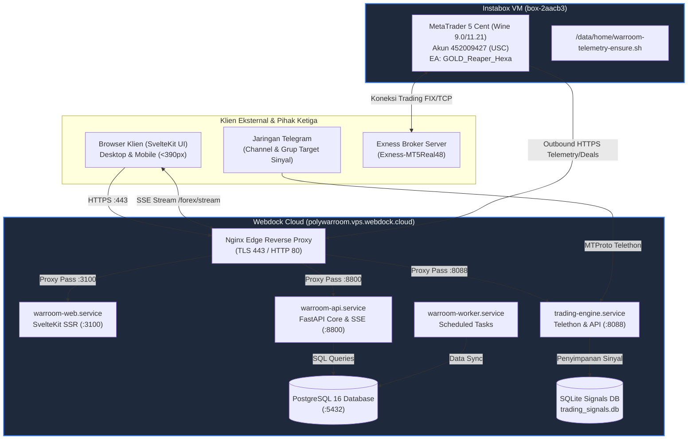

# Arsitektur Sistem & Katalog Kontrak API — War Room Platform

Dokumen ini mendefinisikan arsitektur sistem, peta topologi jaringan, aliran data, dan spesifikasi resmi OpenAPI 3.1 untuk antarmuka pemrograman aplikasi (API) pada platform **War Room**.

---

## 1. Topologi Arsitektur Sistem

Platform War Room dirancang dengan pendekatan modular berbasis micro-services yang menghubungkan klien browser, server inti, runner eksekusi pasar valuta asing (Forex), jaringan sinyal Telegram, serta broker likuiditas.

### 1.1. Diagram Topologi (Mermaid & ASCII)



```
+---------------------------------------------------------------------------------------------------------+
|                                    PETA TOPOLOGI FISIK & PORT JARINGAN                                  |
+---------------------------------------------------------------------------------------------------------+
|                                                                                                         |
|   [ Browser Klien ]  <====== HTTPS (TLS 443) ======> [ Nginx Proxy @ polywarroom.vps.webdock.cloud ]    |
|   - SvelteKit UI                                              |                |                        |
|   - EventSource SSE                                           |                |                        |
|                                                               v                v                        |
|                                                     [ warroom-web ]     [ warroom-api ]                 |
|                                                       Port :3100          Port :8800                    |
|                                                                                |                        |
|   [ Instabox VM: box-2aacb3 ]                                                  v                        |
|   - Wine MT5 Cent (452009427) ========= HTTPS Outbound ==============> [ PostgreSQL 16 ]               |
|   - EA GOLD_Reaper_Hexa                 (Header: X-Warroom-Token)         Port :5432                    |
|                                                                                                         |
|   [ Jaringan Telegram ] ================ MTProto ================> [ trading-engine ]                   |
|   - Target Channels                                                   Port :8088                        |
|                                                                                |                        |
|                                                                                v                        |
|                                                                       [ trading_signals.db ]            |
|                                                                                                         |
+---------------------------------------------------------------------------------------------------------+
|   [ DECOMMISSIONED HOST ]: Azure VM2 (36525553) — DIISOLASI TOTAL & DILARANG DIAKSES                   |
+---------------------------------------------------------------------------------------------------------+
```

---

## 2. Skema Autentikasi & Otorisasi

API War Room mendukung 2 mekanisme autentikasi resmi:

| Skema Autentikasi | Lokasi Pengiriman | Deskripsi & Kegunaan |
|---|---|---|
| **Sesi Cookie Pengguna (`wr_session`)** | Cookie: `wr_session=<hash>` | Digunakan oleh antarmuka Web SvelteKit untuk navigasi pengguna terautentikasi. Diterbitkan melalui endpoint `/api/v1/auth/login`. |
| **Header Token Layanan (`X-Warroom-Token`)** | Header: `X-Warroom-Token: <token>` | Digunakan oleh EA MetaTrader 5 di Instabox dan skrip otomatisasi untuk telemetri serta pelaporan transaksi deal. Nilai token dikonfigurasi melalui `WARROOM_SERVICE_TOKEN` / `/etc/warroom/service_token.env`. |

*Catatan*: Header `Authorization: Bearer <token>` tidak didukung oleh backend War Room API (CORS dan auth dependencies hanya menerima cookie `wr_session` dan header `X-Warroom-Token`).

---

## 3. Katalog Endpoint OpenAPI 3.1

### 3.1. Ingestion Deal MT5 Cent (`POST /api/v1/tencent/mt5/deal`)

Mencatat tiket deal trading yang sudah ditutup secara permanen ke dalam tabel PostgreSQL `trades` dan berkas cadangan `deals.csv`.

- **Metode**: `POST`
- **Path**: `/api/v1/tencent/mt5/deal`
- **Autentikasi**: `X-Warroom-Token` atau Cookie Admin `wr_session`
- **Request Body (application/json)**:
  ```json
  {
    "ticket": 12849502,
    "position": 12849502,
    "symbol": "XAUUSDc",
    "side": "BUY",
    "volume": 0.01,
    "open_time": "2026-11-12T10:15:00Z",
    "open_price": 2650.25,
    "close_time": "2026-11-12T10:30:00Z",
    "close_price": 2655.75,
    "profit": 55.00,
    "swap": 0.0,
    "commission": -0.50,
    "magic": 1001,
    "comment": "reaper_v1",
    "account": "452009427",
    "strategy_version": "GOLD_Reaper_Hexa_v2",
    "currency": "USC",
    "cent_factor": 100.0
  }
  ```
- **Aturan Pemetaan Database**:
  - `Trade.venue` = `'forex'`
  - `Trade.mode` = `'live'`
  - `Trade.ext_id` = `ticket` (12849502)
  - `Trade.pnl_usd` = `(profit + swap + commission) / cent_factor` = `54.50 / 100.0` = `0.545`
  - `Trade.evidence_json` = `{"currency": "USC", "cent_factor": 100.0, "net_usc": 54.50, "raw_profit": 55.00}`
- **Respons Sukses (200 OK)**:
  ```json
  {
    "status": "OK",
    "ticket": 12849502,
    "net": 54.50,
    "currency": "USC",
    "cent_factor": 100.0
  }
  ```
  *Catatan*: Nilai `pnl_usd` dihitung dan disimpan langsung ke dalam tabel `Trade` PostgreSQL (`trades.pnl_usd`) via `ke_trade()`, dan tidak dikembalikan pada payload respons HTTP API (`services/api/src/warroom_api/routers/tencent.py:744-750`).
- **Error Responses**:
  - `400 Bad Request`: Ticket $\le 0$ atau format waktu tidak valid.
  - `403 Forbidden`: Token invalid atau IP tidak diizinkan.

---

### 3.2. Telemetri Real-Time MT5 (`POST /api/v1/tencent/mt5/telemetry`)

Menerima snapshot status live akun, metrik broker, posisi terbuka, dan pending order dari runner EA setiap 5 detik.

- **Metode**: `POST`
- **Path**: `/api/v1/tencent/mt5/telemetry`
- **Autentikasi**: `X-Warroom-Token` atau Cookie Admin `wr_session`
- **Request Body (application/json)**:
  ```json
  {
    "account": "452009427",
    "broker": "Exness",
    "currency": "USC",
    "cent_factor": 100.0,
    "balance": 1074.81,
    "equity": 1079.25,
    "floating_pnl": 4.44,
    "margin": 15.20,
    "free_margin": 1064.05,
    "positions": [
      {
        "ticket": 12850111,
        "symbol": "XAUUSDc",
        "type": "BUY",
        "volume": 0.01,
        "open_price": 2652.10,
        "current_price": 2653.20,
        "sl": 2647.00,
        "tp": 2662.00,
        "profit": 4.44
      }
    ],
    "pending_orders": [],
    "total_trades_today": 8,
    "win_rate_pct": 75.0,
    "wins_today": 6,
    "losses_today": 2,
    "win_rate_today_pct": 75.0,
    "net_pnl_today_usd": 0.35,
    "bid": 2653.20,
    "ask": 2653.40,
    "spread_pts": 20,
    "digits": 2,
    "atr_m5": 2.45,
    "ema9_m5": 2651.80,
    "ema21_m5": 2649.50
  }
  ```
- **Respons Sukses (200 OK)**:
  ```json
  {
    "status": "OK",
    "received_at": 1794398100,
    "account": "452009427",
    "action": "OK"
  }
  ```
  *Catatan*: Bidang `active_subscribers` tidak ada dalam schema backend (`services/api/src/warroom_api/routers/tencent.py:494-526`). Respons standar mengembalikan `action: "OK"`. Bila sinkronisasi kode EA versi baru dipicu untuk akun primer, respons dapat mengembalikan `action: "SYNC_EA_V2"` disertai perintah eksekusi `exec_powershell`.

---

### 3.3. Server-Sent Events Forex Stream (`GET /api/v1/tencent/forex/stream`)

Menyediakan sambungan streaming real-time berlatensi rendah ke browser untuk metrik Forex Cockpit.

- **Metode**: `GET`
- **Path**: `/api/v1/tencent/forex/stream`
- **Query Parameter**:
  - `account` (string, opsional): Nomor akun target. Default: `452009427` (Exness Real Cent).
- **Header Respons**:
  - `Content-Type: text/event-stream`
  - `Cache-Control: no-cache`
  - `Connection: keep-alive`
- **Format Payload SSE**:
  ```http
  HTTP/1.1 200 OK
  Content-Type: text/event-stream
  Cache-Control: no-cache
  Connection: keep-alive

  retry: 3000

  data: {"connected": true, "account": "452009427", "broker": "Exness", "currency": "USC", "cent_factor": 100.0, "balance": 1074.81, "equity": 1079.25, "floating_pnl": 4.44, "margin": 15.20, "free_margin": 1064.05, "bid": 2653.20, "ask": 2653.40, "spread_pts": 20, "positions": [{"ticket": 12850111, "symbol": "XAUUSDc", "type": "BUY", "volume": 0.01, "open_price": 2652.10, "current_price": 2653.20, "profit": 4.44}], "last_seen_ts": 1794398100}

  : ping
  ```

---

### 3.4. Riset & Riwayat Run Strategi (`GET /api/v1/research/runs`)

Menyediakan data katalog hasil eksperimen riset dan backtest kuantitatif.

- **Metode**: `GET`
- **Path**: `/api/v1/research/runs`
- **Query Parameter**:
  - `research_key` (string, opsional): Kunci pengelompokan riset (misal `reaper_g1`, `smc_crypto`).
- **Respons Sukses (200 OK)**:
  ```json
  {
    "runs": [
      {
        "id": "run-20261102-gold-01",
        "research_key": "reaper_g1",
        "name": "GOLD Reaper Walk-Forward Q3-Q4",
        "status": "completed",
        "metrics": {
          "total_trades": 420,
          "win_rate": 0.68,
          "profit_factor": 1.85,
          "sharpe_ratio": 2.14,
          "max_drawdown": 0.082
        },
        "created_at": "2026-11-02T14:00:00Z"
      }
    ]
  }
  ```

---

### 3.5. Papan Peringkat Strategi (`GET /api/v1/leaderboard`)

Menyajikan peringkat performa strategi lintas pasar (Forex, Crypto, Saham) berdasarkan fakta akurasi terverifikasi.

- **Metode**: `GET`
- **Path**: `/api/v1/leaderboard` (Alias: `/api/v1/leaderboard/strategi`)
- **Respons Sukses (200 OK)**:
  ```json
  {
    "as_of": 1794398100,
    "leaderboard": [
      {
        "rank": 1,
        "strategy_id": "gold_reaper_hexa",
        "market": "forex",
        "equity_usd": 1074.81,
        "win_rate": 0.75,
        "expectancy_r": 1.42,
        "max_drawdown_pct": 5.4,
        "total_trades": 86,
        "fees_usd": 4.20,
        "status": "active"
      },
      {
        "rank": 2,
        "strategy_id": "crypto_smc_pullback",
        "market": "crypto",
        "equity_usd": 5420.00,
        "win_rate": 0.64,
        "expectancy_r": 1.15,
        "max_drawdown_pct": 8.1,
        "total_trades": 112,
        "fees_usd": 12.50,
        "status": "active"
      }
    ]
  }
  ```

---

### 3.6. Status Operasional Sistem (`GET /api/v1/sistem/status`)

Menyajikan status kesehatan unit-unit systemd dan kesegaran berkas data operasional.

- **Metode**: `GET`
- **Path**: `/api/v1/sistem/status`
- **Autentikasi**: Wajib sesi aktif (`dependencies=[Depends(current_user)]` via cookie `wr_session`).
- **Catatan Rute**: Rute resmi adalah `/api/v1/sistem/status`. Alias `/api/v1/system/status` tidak tersedia (menghasilkan HTTP 404).
- **Respons Sukses (200 OK)**:
  ```json
  {
    "waktu": 1794398100,
    "unit_total": 10,
    "unit_sehat": 10,
    "unit": [
      { "unit": "warroom-api", "aktif": "active", "sehat": true },
      { "unit": "warroom-web", "aktif": "active", "sehat": true },
      { "unit": "warroom-worker", "aktif": "active", "sehat": true },
      { "unit": "trading-engine", "aktif": "active", "sehat": true },
      { "unit": "nginx", "aktif": "active", "sehat": true }
    ],
    "berkas": [
      {
        "berkas": "/var/lib/warroom/telemetry_log.csv",
        "ada": true,
        "umur_s": 4,
        "basi": false,
        "ambang_s": 120
      }
    ]
  }
  ```

---

### 3.7. Endpoint Autentikasi Pengguna

#### Login Pengguna (`POST /api/v1/auth/login`)
- **Body**: `{"username": "admin", "password": "<plain_password>", "totp": null}`
- **Respons (200 OK)**: `{"ok": true}`
- **Header Set-Cookie**: `wr_session=<hash>; Path=/; HttpOnly; SameSite=Lax; Secure; Max-Age=43200`

#### Logout Pengguna (`POST /api/v1/auth/logout`)
- **Autentikasi**: Wajib sesi aktif (cookie `wr_session`).
- **Respons (200 OK)**: `{"ok": true}`

#### Profil Pengguna Terautentikasi (`GET /api/v1/auth/me`)
- **Autentikasi**: Wajib sesi aktif (cookie `wr_session`).
- **Respons (200 OK)**: `{"username": "admin", "role": "admin"}`

---

### 3.8. Telegram Signal Engine API (Port :8088)

Disediakan oleh modul `trading-engine` untuk pilar Intelligence War Room.

#### Mengambil Sinyal Terbaru (`GET /api/signals`)
- **Query Parameter**:
  - `limit` (integer, default 50): Jumlah maksimum sinyal yang dikembalikan (1-500).
  - `category` (string, opsional): Filter kategori (`FOREX`, `SAHAM`, `CRYPTO`, `GENERAL`, atau `ALL`).
  - `search` (string, opsional): Kata kunci pencarian dalam teks pesan atau nama channel.
- **Respons (200 OK)**:
  ```json
  {
    "status": "OK",
    "count": 50,
    "data": [
      {
        "id": 1420,
        "channel_id": "-100158492019",
        "channel_name": "Callisto FX",
        "category": "FOREX",
        "message_text": "GOLD BUY NOW 2650 SL 2645 TP 2662",
        "timestamp": "2026-11-12 10:14:22",
        "views": 1250,
        "forwards": 14,
        "parsed": {
          "symbol": "XAUUSD",
          "action": "BUY",
          "entry": 2650.0,
          "sl": 2645.0,
          "tp": 2662.0,
          "risk_reward_ratio": 2.4
        }
      }
    ]
  }
  ```

#### Statistik Aktivitas Engine (`GET /api/stats`)
- **Respons (200 OK)**:
  ```json
  {
    "status": "OK",
    "stats": {
      "total": 120,
      "forex": 80,
      "saham": 10,
      "crypto": 20,
      "general": 10
    }
  }
  ```
