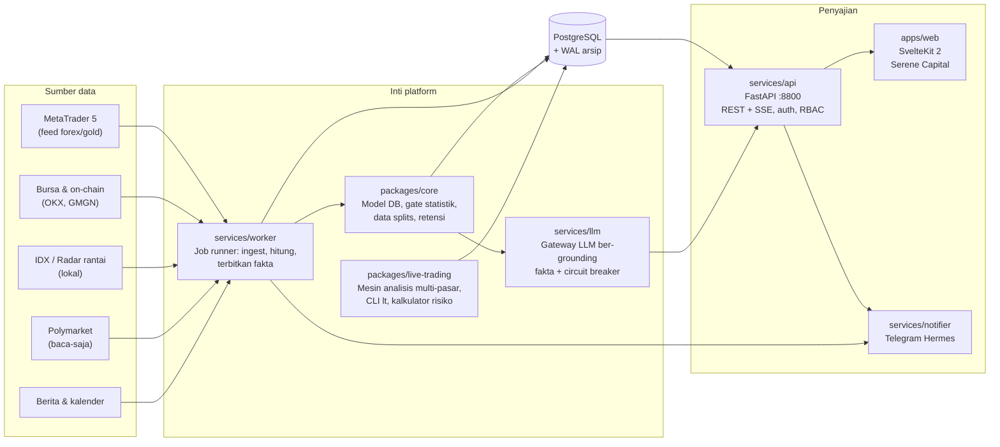
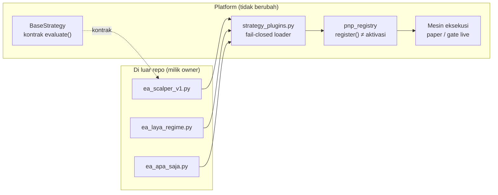
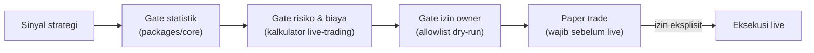

# Arsitektur War Room

Gambaran aliran data end-to-end. Detail tiap komponen ada di README paket/layanan masing-masing.

## Aliran data utama

## Strategi plug-and-play (PnP)

Strategi/EA eksternal tidak pernah menyentuh kode platform. Loader memuat file `.py`
dari `~/.warroom/strategies` (atau `WARROOM_STRATEGY_PATH`) saat proses start.

Sifat penting:

- **Fail-closed**: file tanpa `STRATEGY`, class yang salah, atau error eksekusi →
  `PluginStrategyError`; tidak ada registrasi parsial diam-diam.
- **Registrasi ≠ aktivasi**: `pnp_registry.register()` hanya mendaftar; strategi aktif
  diubah eksplisit via `pnp_registry.set_active_strategy(key)`.
- File berawalan `_` di-skip (boleh dipakai sebagai utilitas bersama).

## Gerbang keselamatan live

Percobaan eksekusi live melewati lapisan berurutan — tidak ada jalur pintas:

Ambang gate dan rumus break-even **hanya boleh diubah manusia (owner)** —
lihat `AGENTS.md`.
